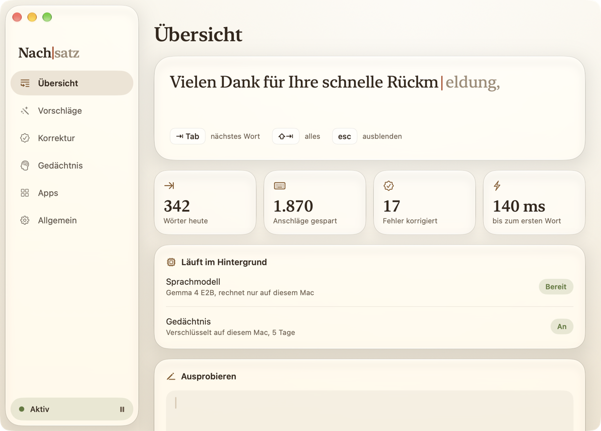
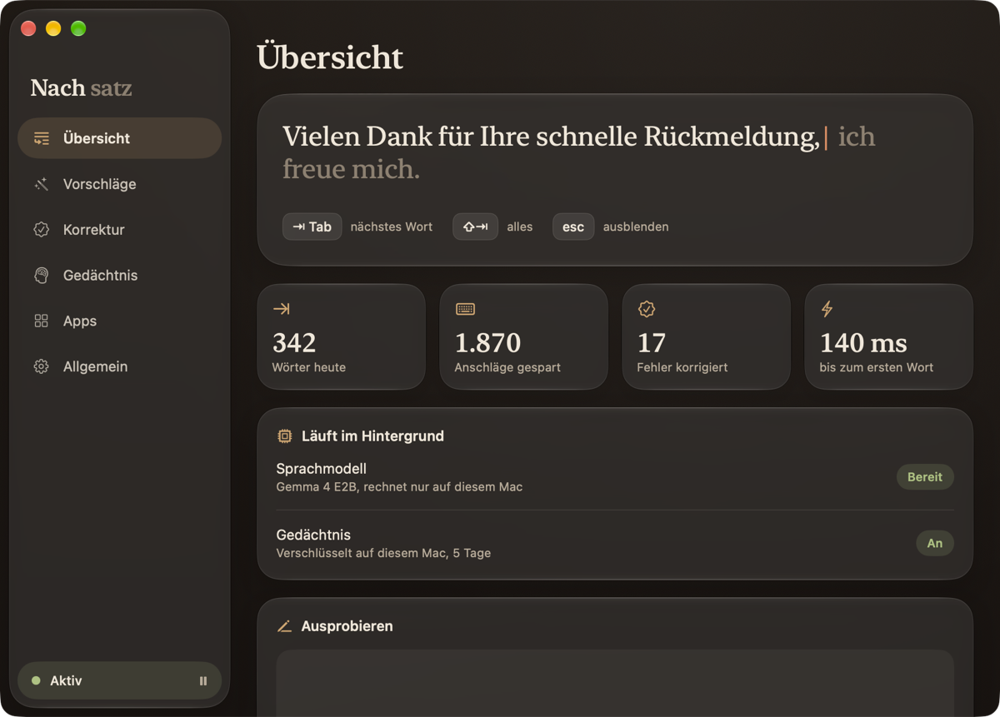
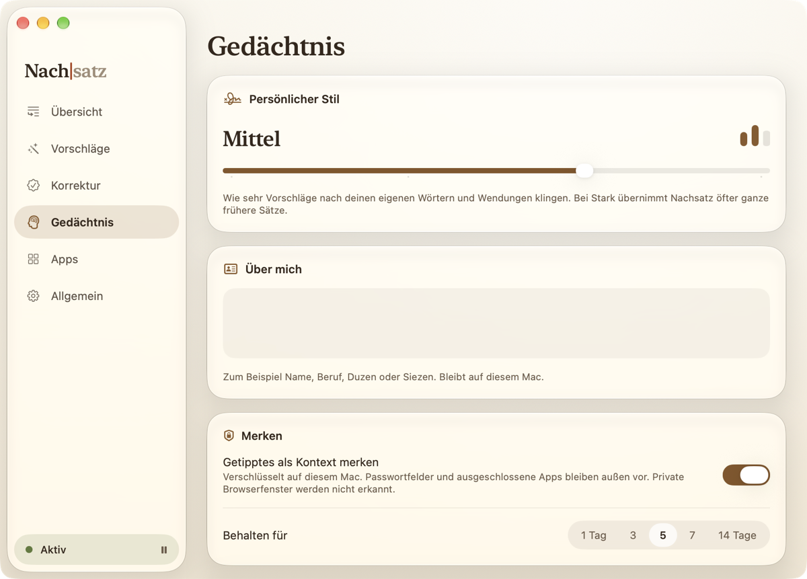

<p align="center"></p>

<h1 align="center">Nachsatz</h1>

<p align="center">Inline text completion for macOS, in (almost) every app. Runs entirely on your Mac.<br>
<a href="README.de.md">Deutsch</a></p>

---

Nachsatz reads the text field you are typing in and suggests how the sentence might go on, in gray, right at the caret. Press Tab to take the next word. It also fills gaps in the middle of a sentence, underlines typos and grammar mistakes you can fix with one click, and can learn your own phrasing for a few days. German and English work best. The user interface is in German.

**No cloud, no account, no telemetry.** The language model (Gemma 4 E2B) runs locally through llama.cpp.

> Early version. It works well in the apps listed below, others are untested. Expect rough edges.

## Requirements

- Mac with Apple silicon, 16 GB of memory recommended
- macOS 26 or newer
- Xcode Command Line Tools (`xcode-select --install`), full Xcode is not needed
- about 3.5 GB of disk space for the model

## Install

```bash
git clone https://github.com/bastiansembach-a11y/nachsatz.git
cd nachsatz
./scripts/setup.sh
./build.sh
open Nachsatz.app
```

`setup.sh` installs llama.cpp with Homebrew and downloads the model. It asks before each step and verifies the checksum. There are no prebuilt, notarized releases yet.

Then grant access under **System Settings > Privacy & Security > Accessibility** (macOS 27: "Device Control & Data Access"). Nachsatz shows a card you can drag its icon from if it is missing in the list.

**After a rebuild** macOS forgets the grant because the app is only signed ad hoc. Remove the old entry and add it again, or sign with your own certificate: `SIGN_ID="Apple Development: …" ./build.sh`.

## Keys

| Key | Action |
| --- | --- |
| Tab | take the next word |
| Shift-Tab | take the whole suggestion (the two can be swapped) |
| Esc | hide the suggestion |
| Click on red | fix the typo |
| Click on blue | fix grammar and commas in the sentence |
| Option-click | ignore from now on |

## Features

- **Suggestions while you type,** streamed word by word
- **Fill in the middle:** put the caret into a sentence
- **Spelling and grammar:** one click, undo with Cmd-Z
- **Memory:** what you typed yourself in the last 1 to 14 days, encrypted, off per app if you like
- **Personal style:** off, light, medium, strong
- **Caution:** only shows what the model considers likely and stops where it gets unsure (off, light, medium, strong)
- **Word counter** in the menu bar
- **Per-app switch and diagnosis:** see why there was no suggestion

<p> </p>

## App support

| App | Status |
| --- | --- |
| TextEdit, Obsidian, WhatsApp, Chromium-based browser | exact caret, works |
| Claude desktop app | rejects accessibility queries, so only a floating bubble based on what you just typed |
| Notion, Discord, Word, Mail, Safari | not tested yet, reports welcome |
| Terminals, IDEs, password managers | excluded by default |

## Measured

On an M3 Mac with 16 GB. Small test sets, so treat these as orientation.

| | Result |
| --- | --- |
| First word (model only) | 0.06 s |
| First word in daily use | about 0.14 to 0.16 s |
| Whole suggestion | 0.23 s |
| Next word correct | German 39/90, English 45/96 |
| Rest of a started word correct | German 33/42, English 28/35 |
| Corrections | 39/46 exact, 0/81 false alarms |

Larger test set (`data/predict.json`, 1767 places in 63 texts of different kinds, never used for tuning):

| | Caution off | Caution medium (default) |
| --- | --- | --- |
| Suggestion shown | 99.8 % | 80.9 % |
| First word of a shown suggestion right | 54.1 % (word boundary 44.8 %, inside a word 81.3 %) | 61.7 % |
| Wrong suggestion shown | 45.8 % of all places | 31.0 % |

A header line built from the app and the window title (for example "Betreff: …" above an email) raised the first word right from 52.2 % to 57.8 % and the saved keystrokes by 27 % (every third word of the same set, `Compare llama rahmen`). The window titles in the test set were written to fit the texts, so real subjects will help somewhat less.

The model's own probability is well calibrated: when it gives the first word 0.9 or more, that word is right 92 % of the time, below 0.1 only 9 %. Asking llama-server for these probabilities did not slow down the first word (median 0.062 s with, 0.072 s without).

Reproduce with `swift run -c release Compare llama neu` and `swift run -c release Compare llama korrektur data/proof-1.json data/proof-2.json`.

For a larger test set (`data/predict.json`, about 60 texts of different kinds, never used for tuning) run `swift run -c release Compare llama treffer`. It computes every suggestion once and then reports how often a suggestion is shown, how often the shown one is right and how many keystrokes it saves: for thresholds on the first word (at a word boundary and inside a word), for rules that cut the end of a suggestion, and for the four caution levels of the app. Add `schnell` to test only every third word, `beispiele` to print examples. `Compare llama tempo` compares the speed with and without token probabilities. `Compare llama rahmen` compares prompts with and without a header line built from the app and the window title (add `voll` for every word).

## Privacy

Nachsatz needs the Accessibility permission, which lets it read text fields and key presses. [PRIVACY.md](PRIVACY.md) explains exactly what it reads, keeps and logs. Please read it before granting access.

## How it works

```
Sources/NachsatzCore   text logic, model, memory, style (no UI)
Sources/Nachsatz       menu bar app: field reading, key tap, overlay, window
Sources/Check          logic tests
Sources/Compare        quality and speed measurements
```

- **Reading fields:** Accessibility ranges in native apps, text markers in web and Electron editors.
- **Completing words:** the started word is removed from the prompt and forced through a grammar, so the model never sees word fragments.
- **Speed:** the text window moves in steps of 400 characters so the prompt cache stays valid, output is streamed, and stale requests are cancelled.
- **Correction:** few-shot prompt, then a word diff with strict filters. Before replacing, the selected text is compared again.

## Development

```bash
swift run -c release Check --logic                          # logic tests, no model needed
./build.sh && Nachsatz.app/Contents/MacOS/Nachsatz --selftest out.png
Nachsatz.app/Contents/MacOS/Nachsatz --shots <folder>       # pictures of every page, made-up data
```

Contributions are welcome, see [CONTRIBUTING.md](CONTRIBUTING.md).

## License

[MIT](LICENSE). The model and llama.cpp are separate projects with their own licenses, see [THIRD_PARTY.md](THIRD_PARTY.md).
